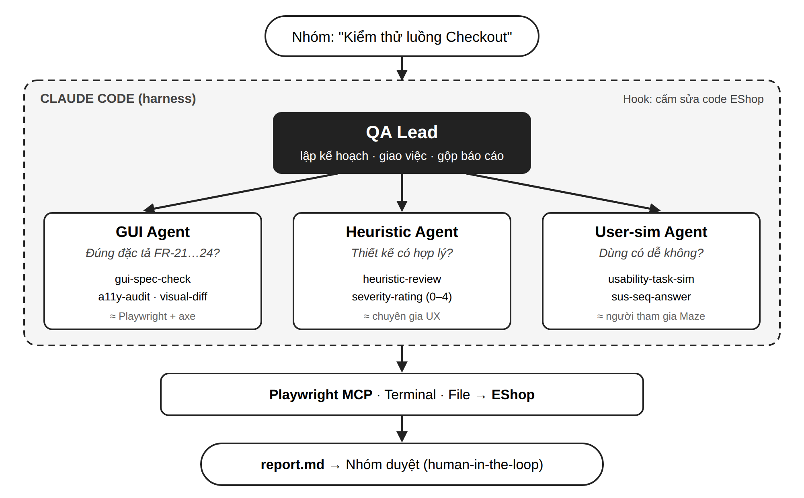
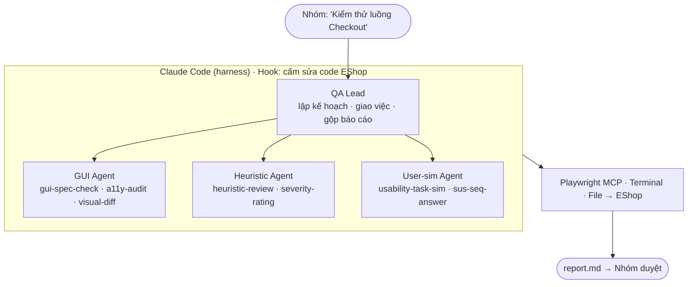

# Proposal Seminar T1 — GUI & Usability Testing

**Nhóm 09** · Đề tài **T1 — GUI & Usability Testing** · GVTH: HTThanh

| MSSV | Họ và tên |
| --- | --- |
| 20120359 | Nguyễn Đức Quang |
| 23120337 | Bùi Minh Quân |
| 23120328 | Bửu Huỳnh Vĩnh Phúc |

Nhóm đề xuất tìm hiểu GUI & Usability Testing trên luồng Checkout của EShop, dùng 2 công cụ truyền thống: **Playwright** (GUI tự động) và **Maze** (usability test theo nhiệm vụ). Công cụ thứ 3 là phần AI: một **hệ multi-agent chạy trong agent harness (Claude Code)**: một agent điều phối giao việc cho 3 subagent chuyên môn, mỗi subagent có bộ **Agent Skills** riêng.


## 1. Tổng quan & phạm vi

**Đề tài:** T1 — GUI & Usability Testing. Seminar giúp các bạn chưa tìm hiểu chủ đề có thể tự kiểm thử giao diện và đánh giá tính khả dụng ở mức cơ bản, và biết cách dùng AI agent để tự động hóa một phần công việc đó.

**SUT (hệ thống được kiểm thử):** EShop Frontend Web (React + Vite, `http://localhost:5173`). Trọng tâm là **luồng Checkout**: Trang chủ → Chi tiết sản phẩm → Giỏ hàng → Thanh toán (nhập coupon ở trang Thanh toán). Luồng Quên mật khẩu 2 bước (FR-03) dùng làm luồng phức tạp bổ sung.

**Tiêu chí kiểm thử có sẵn:** đặc tả EShop có các mục FR-21 đến FR-24 dành riêng cho GUI. Ví dụ:

- Mỗi trang đúng 1 thẻ `<h1>`, ảnh sản phẩm phải có `alt`.
- Giá luôn dạng `₫` có phân cách hàng nghìn; nút tích cực màu xanh, nút nguy hiểm màu đỏ.
- Trường bắt buộc có dấu `*`; lỗi hiện phía trên nút submit; form nhiều bước có Step Indicator.
- Navbar highlight trang hiện tại, badge số lượng giỏ hàng, breadcrumb ở trang con, dialog xác nhận khi xóa.

**Phạm vi:**

| Nằm trong phạm vi | Ngoài phạm vi (trừ khi GVTH yêu cầu) |
| --- | --- |
| GUI testing: bố cục, control, trạng thái, visual regression, accessibility | Kiểm thử chức năng E2E (thuộc T2 Web Automation) |
| Usability testing: test theo nhiệm vụ, heuristic evaluation, heatmap, SUS | Performance, security, API |
| AI agent (harness + subagent + skill) hỗ trợ đánh giá GUI/usability | Mobile app (Expo), trừ khi còn thời gian |
| Compatibility ở mức nhẹ (viewport, 2–3 trình duyệt) | Device farm thật trả phí |

## 2. Outline nội dung seminar

Seminar gồm 8 phần, đi từ lý thuyết → công cụ → AI → bài tập cho lớp. Mỗi công cụ đều có 3 demo và được quay clip đăng YouTube.

1. **Mở đầu**
   - Vì sao phần mềm chạy đúng vẫn thất bại nếu giao diện khó dùng; giới thiệu SUT EShop và các lỗi GUI thật nhóm tìm được.
2. **Lý thuyết GUI Testing**
   - Định nghĩa; các thành phần cần kiểm tra (visuals, controls).
   - Checklist theo từng control: text box, button, dropdown, link, trang lỗi.
   - Lỗi GUI hay gặp (overlay z-index, hiển thị `NaN ₫`, double-submit) và vì sao GUI testing khó (event-driven, sự kiện ngoài ý muốn, phụ thuộc ẩn).
   - Chiến lược tự động hóa: cái gì nên tự động, cái gì giữ thủ công; Page Object Model; visual regression; accessibility (WCAG).
3. **Lý thuyết Usability Testing**
   - Định nghĩa theo ISO 9241-11 (hiệu quả, hiệu suất, hài lòng); 6 thành phần của Rubin.
   - 10 heuristic của Nielsen và thang điểm severity 0–4.
   - Phương pháp: moderated / unmoderated, think-aloud, remote / in-lab, guerrilla.
   - Chỉ số: task success rate, time on task, error rate, misclick rate, SUS, SEQ.
   - Usability test plan 9 phần.
4. **Khảo sát & so sánh công cụ** (mục 3 của proposal này).
5. **Hướng dẫn & demo 2 công cụ truyền thống (Playwright, Maze)** — mỗi công cụ gồm: lý thuyết & thuật ngữ riêng, chức năng chính, nguyên lý hoạt động, 3 demo (cài đặt / cơ bản / luồng phức tạp), điểm yếu (mục 4).
6. **Ứng dụng AI: multi-agent harness** (mục 5)
   - Kiến trúc của nhóm: QA Lead điều phối 3 subagent (GUI, Heuristic, Người dùng giả lập), mỗi subagent một bộ skill.
   - Demo 3 mức và so sánh người vs AI.
7. **Bài tập áp dụng cho lớp**
   - **Bài chính trên lớp — "Heuristic Showdown" (khoảng 20–25 phút):** lớp tìm ≥ 5 vi phạm heuristic trên bộ ảnh Checkout (do agent chụp sẵn), chấm severity; sau đó nhóm chạy subagent Heuristic trực tiếp và cả lớp so kết quả người vs AI.
   - Bài về nhà 1: viết test Playwright kiểm tra 1 yêu cầu FR-21 (ví dụ: mỗi trang đúng 1 `<h1>`).
   - Bài về nhà 2: viết thêm 1 skill nhỏ (ví dụ `price-format-check`) và gắn vào subagent GUI.
8. **Tổng kết** — so sánh công cụ, bài học về con người vs AI, Q&A.

## 3. Khảo sát & so sánh công cụ

Nhóm chọn 3 công cụ chính: **Playwright** (kiểm tra giao diện tự động), **Maze** (test với người dùng theo nhiệm vụ) và **Claude Code + Playwright MCP** (agent harness cho phần AI-augmented). Các công cụ còn lại là dự phòng hoặc dùng để so sánh.

**Vì sao không chọn Microsoft Clarity:** Clarity miễn phí và có Copilot, nhưng với 5–10 người tham gia thì heatmap và recording quá mỏng để phân tích; heatmap và đường đi click đã có trong Maze; và nhóm cần dồn thời gian cho phần multi-agent. Góc nhìn "quan sát người dùng thật lâu dài" (Clarity, Hotjar) vẫn được trình bày ở phần lý thuyết và dùng làm ví dụ cho giới hạn của AI (mục 5).

| Công cụ | Nhóm | Chi phí (gói dùng được) | Độ khó học | Phù hợp EShop | Tự động hóa | AI | Community | Vai trò |
| --- | --- | --- | --- | --- | --- | --- | --- | --- |
| **Playwright** (+ axe-core) | GUI tự động, visual regression, a11y | Miễn phí, open-source (Apache-2.0) | Trung bình (JS/TS) | Cao: chạy thẳng trên localhost | Fully automated | Qua MCP + LLM | Rất lớn (Microsoft, GitHub, docs đầy đủ) | **Chính** |
| **Maze** | Usability test theo nhiệm vụ (unmoderated) | Gói Free: 1 study/tháng | Thấp | Trung bình: cần URL public | Semi-automated | Maze AI (tóm tắt, gợi ý câu hỏi) | Trung bình (help center, blog) | **Chính** |
| Microsoft Clarity | Heatmap, session recording | Miễn phí | Thấp | Trung bình: gắn script, cần URL public | Semi-automated | Copilot tóm tắt phiên | Trung bình (Microsoft Learn) | Đã xem xét, không chọn |
| **Claude Code + Playwright MCP** | AI agent harness (subagent, skills, hooks) | Cần gói Claude trả phí hoặc API key | Trung bình | Cao: chạy trên máy, điều khiển trình duyệt | Fully automated (agent) | Là AI | Lớn, phát triển nhanh | **Chính (AI)** |
| GitHub Copilot agent mode | AI agent harness trong VS Code | Miễn phí cho sinh viên (GitHub Student Pack) | Thấp | Cao | Fully automated (agent) | Là AI | Rất lớn | Dự phòng cho Claude Code |
| Hotjar | Heatmap, recording, survey | Có gói Basic miễn phí (giới hạn) | Thấp | Trung bình | Semi-automated | Hotjar AI | Lớn | Đã xem xét, không chọn |
| UXtweak | Usability test, heatmap | Có gói Free (giới hạn) | Thấp | Trung bình | Semi-automated | Có | Nhỏ | Dự phòng cho Maze |
| BackstopJS | Visual regression | Miễn phí, open-source | Thấp | Cao | Fully automated | Không | Trung bình | So sánh với Playwright |
| Lighthouse / axe DevTools | Accessibility audit | Miễn phí | Thấp | Cao | Fully automated | Không | Lớn | Dùng kèm Playwright |
| Applitools Eyes | Visual AI | Chỉ có free trial, gói trả phí đắt | Trung bình | Cao (SDK cho Playwright) | Fully automated | Visual AI | Trung bình | Demo phụ nếu trial còn |
| BrowserStack Live | Compatibility, thiết bị thật | Trial 30 phút, tối đa 1 phút/thiết bị | Thấp | Cao (BrowserStack Local cho localhost) | Thủ công | Không | Lớn | Tuỳ GVTH |

**Lý do chọn (3 ý):**

- **Phủ đủ hai nửa đề tài:** Playwright kiểm tra *giao diện có đúng đặc tả không*; Maze trả lời *người dùng có dùng được không*; hệ AI agent làm lại cả hai việc đó để so sánh người vs AI.
- **Đáp ứng bộ ba Record & Playback / Data-driven / Checkpoints**, rõ nhất ở Playwright (`codegen`, test tham số hóa, `expect`/`toHaveScreenshot`).
- **AI gắn với đúng hướng AI của đề T1 (AI heuristic reviewer, screenshot diffing)** nhưng ở dạng tái sử dụng được: harness + subagent + skill chạy lại được trên website khác chỉ bằng cách đổi cấu hình.

**Rủi ro cần xử lý sớm:** Maze cần EShop có URL public. Nhóm sẽ deploy (ví dụ Vercel cho frontend, Render cho backend) hoặc dùng tunnel (ngrok, Cloudflare Tunnel); EShop cố ý có lỗ hổng bảo mật nên chỉ mở URL trong lúc test, dùng dữ liệu giả. Gói Free của Maze chỉ cho 1 study/tháng, nên phải thiết kế study kỹ trước khi chạy. Claude Code cần tài khoản trả phí; nếu không có thì dùng Copilot agent mode bản sinh viên.

**AI Disclosure (khảo sát):** nhóm dùng Claude để tóm tắt tài liệu công cụ và rà soát proposal. Giá, giới hạn gói miễn phí và tính năng (subagent, skills) đã được đối chiếu lại với trang chính thức ở mục 8; bảng lỗi GUI đã được đối chiếu với mã nguồn EShop.

## 4. Công cụ chọn & kịch bản demo

Mỗi công cụ có 3 demo theo yêu cầu: **cài đặt → chức năng cơ bản → luồng phức tạp trên EShop**, và ghi rõ phần nào là Record & Playback, Data-driven, Checkpoints.

### Lỗi GUI thật đã thấy trong code EShop (dùng làm ví dụ xuyên suốt)

| Trang | Hiện tại | Đặc tả yêu cầu | Vị trí trong code |
| --- | --- | --- | --- |
| Giỏ hàng | Nhãn "Tổng tạm tính" | "Tổng cộng" (FR-07) | `Cart.jsx:63` |
| Giỏ hàng | Bấm "Xóa" xóa ngay, không hỏi lại | Phải có dialog xác nhận (FR-07, FR-24) | `Cart.jsx:50-55` |
| Giỏ hàng | Số lượng chỉ hiển thị, không có nút +/- | Có nút +/- (FR-07) | `Cart.jsx:47` |
| Giỏ hàng | Nút "Tiến hành thanh toán" màu xanh lá | Nút tích cực màu xanh dương (FR-21) | `Cart.jsx:71` |
| Giỏ hàng / Checkout | Tiêu đề dùng `<h2>`, không có `<h1>` | Đúng 1 `<h1>` mỗi trang (FR-21) | `Cart.jsx:31`, `Checkout.jsx:80` |
| Checkout | Ô "Tổng tiền thanh toán" sửa được | Không cho sửa (FR-08); vi phạm heuristic H5 | `Checkout.jsx:92-93` |
| Header | Nút "Thoát"; link Giỏ hàng không có badge; không highlight trang hiện tại | "Đăng xuất", có badge, có highlight (FR-23) | `App.jsx:23,29` |

Danh sách lỗi cài sẵn này cũng là **ground truth** (đáp án) để chấm kết quả của AI ở mục 5. Cần chạy EShop để chụp ảnh minh chứng trước khi đưa vào file nộp.

### 4.1 Playwright (+ axe-core) — GUI tự động

**Nguyên lý:** điều khiển Chromium / Firefox / WebKit qua giao thức riêng; tìm phần tử bằng locator (role, text, test id), tự chờ phần tử sẵn sàng (auto-wait); so ảnh chụp với baseline để phát hiện thay đổi giao diện.

**Phân biệt với T2 (Web Automation Testing):** nhóm dùng Playwright để kiểm tra **giao diện trông và phản hồi có đúng không**, không kiểm tra **nghiệp vụ có chạy đúng không**. Thao tác click, điền form chỉ là bước đưa trang về đúng trạng thái cần soi; checkpoint luôn là thuộc tính giao diện.

|  | T1 — nhóm mình kiểm tra | T2 — không làm (thuộc nhóm khác) |
| --- | --- | --- |
| Mục tiêu | Giao diện đúng đặc tả GUI (FR-21–24), nhất quán, truy cập được | Luồng nghiệp vụ cho kết quả đúng (FR-01–20) |
| Ví dụ checkpoint | Đúng 1 `<h1>`; nhãn "Tổng cộng"; nút tích cực màu xanh dương; giá dạng `1.250.000 ₫`; ảnh có `alt`; trường bắt buộc có `*`; lỗi hiện trên nút submit; badge giỏ hàng; thứ tự Tab | Mã SAVE10 giảm đúng 10%; đăng nhập sai 3 lần thì bị khóa; đơn hàng lưu đúng vào CSDL |
| Kỹ thuật | Visual regression (`toHaveScreenshot`), accessibility scan (axe), kiểm tra CSS/thuộc tính (`toHaveCSS`, `toHaveAttribute`), responsive theo viewport, điều hướng bàn phím | Assertion trên dữ liệu, API, trạng thái đơn hàng |
| Trạng thái giao diện | Loading, empty state, lỗi, disabled, hover/focus, dialog xác nhận, toast | — |

Ví dụ một checkpoint thuần giao diện: sau khi thêm sản phẩm, vào `/cart` và kiểm tra nút "Tiến hành thanh toán" có màu xanh dương (`toHaveCSS('background-color', ...)`) và bấm "Xóa" phải mở dialog xác nhận — không kiểm tra giỏ hàng còn bao nhiêu sản phẩm sau khi xóa.

| Demo | Nội dung | Thành phần |
| --- | --- | --- |
| 1. Cài đặt | `npm init playwright@latest`, cài `@axe-core/playwright`, chạy test mẫu, mở HTML report | — |
| 2. Cơ bản | `npx playwright codegen http://localhost:5173` ghi lại thao tác thêm sản phẩm vào giỏ → chạy lại; thêm `expect` kiểm tra nhãn "Tổng cộng" | **Record & Playback**, **Checkpoint** |
| 3. Luồng phức tạp | Chạy cùng bộ kiểm tra FR-21–24 cho mọi trang × 3 kích thước màn hình (đọc từ file JSON); chụp ảnh so baseline; quét axe trên luồng Checkout | **Data-driven**, **Checkpoint** (visual + a11y) |

**Lưu ý khi dựng demo 3:** giỏ hàng chỉ lưu trong React state (`CartContext.jsx`), nên `page.goto('/cart')` luôn ra giỏ trống. Với các trang cần trạng thái, file dữ liệu có thêm trường `setup` để test tự thêm sản phẩm qua giao diện trước (chú ý: nút "Thêm vào giỏ" phải bấm 2 lần mới ăn — đây cũng là một lỗi GUI). Vì EShop cố ý có lỗi, phần lớn test sẽ **fail — và đó là kết quả mong muốn** (test tìm ra lỗi); dùng `expect.soft` để một lần chạy liệt kê đủ mọi vi phạm.

Ví dụ test data-driven cho demo 3:

```js
// tests/gui-rules.spec.js
import { test, expect } from '@playwright/test';
import AxeBuilder from '@axe-core/playwright';
import pages from './data/pages.json';
// [{ "name": "home", "path": "/" },
//  { "name": "cart", "path": "/", "setup": "addFirstProductToCart" }, ...]
import * as setups from './setups.js';

const viewports = [
  { name: 'mobile', width: 375, height: 812 },
  { name: 'tablet', width: 768, height: 1024 },
  { name: 'desktop', width: 1440, height: 900 },
];

for (const p of pages) {
  for (const vp of viewports) {
    test(`${p.name} @ ${vp.name} — GUI rules`, async ({ page }) => {
      await page.setViewportSize(vp);
      await page.goto(p.path);
      if (p.setup) await setups[p.setup](page); // dựng trạng thái qua UI

      // FR-21: đúng một <h1>
      await expect.soft(page.locator('h1')).toHaveCount(1);
      // FR-24: mọi ảnh có alt không rỗng
      await expect.soft(page.locator('img:not([alt]), img[alt=""]')).toHaveCount(0);
      // Visual checkpoint so với baseline
      await expect.soft(page).toHaveScreenshot(`${p.name}-${vp.name}.png`, { maxDiffPixelRatio: 0.01 });
      // Accessibility checkpoint (WCAG 2 A/AA)
      const a11y = await new AxeBuilder({ page }).withTags(['wcag2a', 'wcag2aa']).analyze();
      expect.soft(a11y.violations).toEqual([]);
    });
  }
}
```

**Điểm yếu dự kiến:** không đánh giá được "dễ dùng hay không"; ảnh chụp dễ lệch giữa các máy (font, hệ điều hành) gây false positive; axe chỉ bắt được một phần lỗi accessibility; code do `codegen` sinh ra khó bảo trì nếu không chuyển sang Page Object Model; EShop không có `data-testid` nên locator phải dựa vào text/role, dễ gãy khi đổi nhãn.

### 4.2 Maze — usability test theo nhiệm vụ

**Nguyên lý:** tạo một *study* gồm các *mission* (nhiệm vụ) trên website thật; gắn Maze snippet để ghi lại đường đi, click, heatmap; người tham gia tự làm qua link (unmoderated); Maze tính tỷ lệ thành công, thời gian, misclick.

**Người tham gia:** khoảng 5 người ngoài nhóm (bạn bè, sinh viên lớp khác), tự làm qua link trước buổi seminar; thành viên nhóm không làm người tham gia vì đã biết rõ website.

| Demo | Nội dung | Thành phần |
| --- | --- | --- |
| 1. Cài đặt | Tạo tài khoản, deploy EShop ra URL public, gắn Maze snippet vào `index.html` | — |
| 2. Cơ bản | 1 mission đơn giản + câu hỏi SEQ; tự làm thử và xem kết quả | **Record** (Maze ghi đường đi và màn hình), **Checkpoint** (trang đích = thành công) |
| 3. Luồng phức tạp | Study Checkout đầy đủ với \~5 người, bảng SUS cuối bài; phân tích heatmap, đường đi, gợi ý của Maze AI | **Data-driven** (nhiều người, nhiều nhiệm vụ), **Checkpoint** (expected path) |

Ví dụ mission: *"Bạn có 5.000.000 ₫ và muốn mua một món phụ kiện cho máy tính. Hãy mua một sản phẩm và dùng mã giảm giá VIP100 khi thanh toán."* (sản phẩm rẻ nhất trong dữ liệu mẫu là 4.000.000 ₫). Thành công khi người dùng xác nhận đơn ở trang Thanh toán. Sau mission hỏi: *"Nhiệm vụ này dễ hay khó? (1–7)"*.

**Chuẩn bị dữ liệu:** dùng mã VIP100 (giảm cố định 100.000 ₫) thay vì SAVE10, vì công thức giảm theo % ở backend đang lỗi và sẽ làm nhiễu kết quả usability; mỗi mã chỉ dùng được 1–2 lần/tài khoản nên tạo **một tài khoản riêng cho mỗi người tham gia** và reset dữ liệu (`node database.js`) trước mỗi đợt test.

**Điểm yếu dự kiến:** gói Free chỉ 1 study/tháng; Maze theo dõi chủ yếu theo thay đổi URL nên thao tác trong cùng một trang (như bấm "Áp dụng" coupon) khó đo thành bước riêng (cần kiểm chứng trên Maze Help); unmoderated nên không hỏi lại được vì sao người dùng bị kẹt.

## 5. Ứng dụng AI: Multi-agent Harness cho GUI & Usability Testing

### 5.1 Kiến trúc

Agent chính (**QA Lead**) không tự kiểm thử: nó lập kế hoạch, giao việc cho 3 subagent chuyên môn, rồi gộp báo cáo. Mỗi subagent có bộ skill riêng và dùng chung các tool.

| Agent | Câu hỏi nó trả lời | Skill riêng | Tool |
| --- | --- | --- | --- |
| **QA Lead** (agent chính, điều phối) | Test trang nào, viewport nào, giao cho ai? Gộp kết quả ra sao? | `test-plan`, `report-merge` | Agent (gọi subagent), file system |
| **gui-agent** | Giao diện có đúng đặc tả FR-21…24 không? | `gui-spec-check`, `a11y-audit`, `visual-diff` | Playwright MCP, terminal (chạy Playwright + axe) |
| **heuristic-agent** | Thiết kế có vi phạm 10 heuristic Nielsen không? Nghiêm trọng mức nào? | `heuristic-review`, `severity-rating` | Playwright MCP (chụp ảnh), file system |
| **user-sim-agent** | Một người dùng mới làm nhiệm vụ mua hàng có dễ không? | `usability-task-sim`, `sus-seq-answer` | Playwright MCP |

**Đối chiếu với các cách kiểm thử truyền thống** (mỗi subagent làm "bản AI" của một cách kiểm thử ở mục 4, để so sánh trực tiếp):

| Subagent | Tương ứng với | Quan hệ | So sánh được gì |
| --- | --- | --- | --- |
| `gui-agent` | **Playwright + axe** | Agent dùng chính Playwright và axe làm tool; khác ở chỗ agent tự đọc đặc tả và tự viết test thay vì người viết | Test do agent sinh vs test nhóm tự viết: bắt được bao nhiêu lỗi FR-21…24, có test sai không |
| `user-sim-agent` | **Maze** | Agent làm đúng mission Maze, đóng vai người dùng | Đường đi, chỗ kẹt, SEQ của agent vs 5 người thật |
| `heuristic-agent` | **Đánh giá heuristic thủ công** (Heuristic Showdown) | Không thay công cụ nào, thay chuyên gia UX | Lỗi người thấy vs lỗi AI thấy, độ lệch severity |
| — | **Quan sát người dùng thật lâu dài** (Clarity, Hotjar — không chọn demo) | Không có subagent tương ứng: các công cụ này quan sát người dùng thật trong thời gian dài, agent không tạo ra được dữ liệu đó | Dùng làm ví dụ cho giới hạn của AI: hành vi thật của người dùng không mô phỏng được |



<details><summary>Mã Mermaid (nếu cần sửa sơ đồ)</summary>



</details>

**Cấu trúc thư mục** (đặt trong repo của nhóm, tách khỏi mã EShop):

```text
.claude/
├── agents/
│   ├── gui-agent.md
│   ├── heuristic-agent.md
│   └── user-sim-agent.md
├── skills/
│   ├── test-plan/SKILL.md
│   ├── report-merge/SKILL.md          (+ templates/report.md)
│   ├── gui-spec-check/SKILL.md        (+ rules.json: FR-21…24)
│   ├── a11y-audit/SKILL.md
│   ├── visual-diff/SKILL.md
│   ├── heuristic-review/SKILL.md      (+ nielsen-10.md, schema.json)
│   ├── severity-rating/SKILL.md
│   ├── usability-task-sim/SKILL.md    (+ missions.json)
│   └── sus-seq-answer/SKILL.md
└── settings.json                      (Playwright MCP, hook chặn sửa code)
config.json                            (URL website, danh sách trang, viewport)
```

Ví dụ một subagent (định dạng theo tài liệu Claude Code; trường `skills` nạp sẵn skill vào subagent):

```markdown
---
name: heuristic-agent
description: Đánh giá usability theo 10 heuristic Nielsen trên các trang được giao. Dùng khi cần heuristic evaluation.
tools: Read, Write
mcpServers:
  - playwright
skills:
  - heuristic-review
  - severity-rating
---
Bạn là chuyên gia UX. Với mỗi trang được giao: mở trang, dựng đúng trạng thái,
chụp màn hình ở 3 viewport, đánh giá theo skill heuristic-review, chấm severity
theo skill severity-rating. Chỉ báo lỗi nhìn thấy được; không sửa code.
Trả về JSON đúng schema của skill.
```

Ví dụ phần lõi của skill `heuristic-review/SKILL.md`:

```markdown
---
name: heuristic-review
description: Heuristic evaluation một trang web theo 10 heuristic Nielsen, xuất JSON theo schema.json.
---
1. Đọc nielsen-10.md. Chụp màn hình trang ở viewport được giao.
2. Với mỗi vấn đề nhìn thấy, ghi: heuristic (H1..H10), element, problem,
   evidence (vị trí trên ảnh), fix.
3. Không đoán chức năng không hiển thị. Không báo trùng một vấn đề hai lần.
4. Ghi kết quả vào out/heuristic/<trang>-<viewport>.json theo schema.json.
```

### 5.2 Luồng chạy ví dụ

1. Nhóm gõ: *"Kiểm thử luồng Checkout EShop"*.
2. QA Lead dùng skill `test-plan`: đọc `config.json`, lập danh sách trang (Home, Product, Cart, Checkout) × 3 viewport.
3. QA Lead giao việc **song song** cho 3 subagent.
4. `gui-agent` sinh và chạy test Playwright theo `rules.json` → báo: *"Cart: không có `<h1>`; nút thanh toán màu xanh lá"*.
5. `heuristic-agent` chụp ảnh và soi → báo: *"Cart — H3 User control and freedom: nút Xóa không có xác nhận, severity 3"*.
6. `user-sim-agent` làm mission mua hàng → báo: *"bấm Thêm vào giỏ 1 lần không thấy phản hồi, phải bấm lại; SEQ 4/7"*.
7. QA Lead dùng `report-merge`: gộp, bỏ trùng, xếp theo severity, ghi `report.md` + `report.json`.
8. Nhóm duyệt báo cáo và chấm đúng/sai so với danh sách lỗi có sẵn.

### 5.3 Demo (3 mức như các công cụ khác)

| Demo | Nội dung | Thành phần |
| --- | --- | --- |
| 1. Cài đặt | Cài Claude Code, thêm Playwright MCP, chép thư mục `.claude/agents` và `.claude/skills`, kiểm tra agent nhận ra subagent và skill (`/agents`) | — |
| 2. Cơ bản | Gọi riêng `heuristic-agent` cho trang Giỏ hàng → ra báo cáo JSON/Markdown; so với danh sách lỗi đã biết | **Checkpoint** (so ground truth) |
| 3. Luồng phức tạp | QA Lead điều phối cả 3 subagent trên toàn luồng Checkout × 3 viewport; sau đó **đổi `config.json` sang một website khác** và chạy lại để chứng minh tái sử dụng | **Data-driven** (trang × viewport × mission), **Record** (log từng bước agent), **Checkpoint** |

### 5.4 Đánh giá AI

- **Người vs AI:** cùng một bộ trang, nhóm đánh giá thủ công và hệ agent đánh giá riêng, rồi đếm: lỗi trùng nhau, lỗi chỉ người thấy, lỗi chỉ AI thấy, lỗi AI báo sai (false positive), độ lệch severity.
- **Phân loại lỗi AI báo:** danh sách lỗi cài sẵn của EShop là đáp án nhưng không đầy đủ, nên mỗi lỗi AI báo được xếp vào 1 trong 3 nhóm:

| Nhóm | Ý nghĩa | Tính là |
| --- | --- | --- |
| (a) Đúng, có trong danh sách | Trùng với lỗi cài sẵn | Đúng |
| (b) Đúng, ngoài danh sách | Lỗi thật mà danh sách chưa ghi; phải được ít nhất 2 thành viên cùng xác nhận | Đúng |
| (c) Sai hoàn toàn | Không phải lỗi, hoặc AI bịa (hallucination) | False positive |

**Precision** = (a + b) / tổng số lỗi AI báo. **Recall** chỉ tính trên danh sách cài sẵn: a / tổng số lỗi cài sẵn (phần biết chắc).

- **Độ ổn định:** chạy toàn bộ hệ 3 lần, so mức trùng khớp giữa các lần (LLM không tất định).
- **Chi phí:** ghi số token và thời gian mỗi lần chạy.
- **user-sim-agent vs người thật:** so đường đi, chỗ bị kẹt, điểm SEQ của agent với 5 người tham gia Maze. Điểm SEQ/SUS do agent chấm chỉ là **dữ liệu mô phỏng để đối chiếu**, không gộp chung với điểm của người tham gia thật.

**Kỳ vọng / điểm yếu dự kiến:** AI mạnh ở lỗi bề mặt (nhãn, màu, bố cục, thiếu `<h1>`), yếu ở lỗi phụ thuộc nghiệp vụ và hay chấm severity lệch; agent có thể bịa lỗi (hallucination) hoặc tự ý sửa code nếu không có hook chặn; user-sim-agent không thay được người thật (không bối rối, không thiếu kiến thức như người mới); multi-agent tốn token gấp nhiều lần và khó debug hơn một agent.

Mọi nội dung do AI tạo đều được nhóm review lại, đảm bảo chính xác và nhóm chịu trách nhiệm về nội dung (theo yêu cầu chính chủ của FIT).

## 6. Thuật ngữ thống nhất

**Quy ước chung:** giữ thuật ngữ tiếng Anh trong slide, báo cáo và code; lần đầu xuất hiện trong mỗi tài liệu thì kèm nghĩa tiếng Việt trong ngoặc. Không tự đặt tên mới; ai cần thêm thuật ngữ thì bổ sung vào bảng này.

### Chung

| Thuật ngữ | Cách gọi trong nhóm | Nghĩa |
| --- | --- | --- |
| SUT (System Under Test) | SUT | Hệ thống được kiểm thử — ở đây là EShop Frontend Web |
| GUI (Graphical User Interface) | Giao diện | Phần người dùng nhìn thấy và thao tác: màu, chữ, bố cục, control |
| GUI Testing | Kiểm thử giao diện | Kiểm tra giao diện hiển thị và phản hồi đúng đặc tả |
| Usability | Tính khả dụng | Mức người dùng cụ thể đạt được mục tiêu với hiệu quả, hiệu suất và sự hài lòng (ISO 9241-11) |
| Usability Testing | Kiểm thử khả dụng | Quan sát người dùng đại diện làm nhiệm vụ thật để tìm vấn đề |
| UX (User Experience) | Trải nghiệm người dùng | Toàn bộ cảm nhận khi dùng sản phẩm; rộng hơn usability |
| Accessibility (a11y) | Khả năng truy cập | Người khuyết tật (khiếm thị, dùng bàn phím…) vẫn dùng được |
| WCAG | WCAG | Bộ tiêu chuẩn accessibility của W3C, mức A / AA / AAA |
| Compatibility Testing | Kiểm thử tương thích | Kiểm tra trên nhiều trình duyệt, thiết bị, kích thước màn hình |
| Viewport | Viewport | Vùng hiển thị của trình duyệt; nhóm dùng 3 mức mobile 375, tablet 768, desktop 1440 px |
| Defect / Bug | Lỗi | Kết quả thực tế khác đặc tả hoặc gây cản trở người dùng |
| Ground truth | Đáp án | Danh sách lỗi đã biết chắc, dùng để chấm kết quả của công cụ/AI |

### Usability

| Thuật ngữ | Cách gọi trong nhóm | Nghĩa |
| --- | --- | --- |
| Heuristic Evaluation | Đánh giá heuristic | Chuyên gia soi giao diện theo bộ nguyên tắc, không cần người dùng thật |
| Nielsen's 10 Heuristics | H1–H10 | H1 Visibility of system status · H2 Match between system and real world · H3 User control and freedom · H4 Consistency and standards · H5 Error prevention · H6 Recognition rather than recall · H7 Flexibility and efficiency of use · H8 Aesthetic and minimalist design · H9 Help users recognize, diagnose, and recover from errors · H10 Help and documentation |
| Severity Rating | Mức nghiêm trọng | Thang Nielsen 0–4: 0 không phải lỗi · 1 thẩm mỹ · 2 nhỏ · 3 lớn · 4 thảm họa. **Cả nhóm (và mọi agent) chỉ dùng thang này** |
| Participant | Người tham gia | Người dùng thử trong buổi test (không gọi là "tester") |
| Facilitator / Observer | Người điều phối / quan sát | Người dẫn buổi test / người ghi chép |
| Task / Mission | Nhiệm vụ | Việc cụ thể giao cho người tham gia; "mission" là tên gọi trong Maze |
| Task Scenario | Kịch bản nhiệm vụ | Bối cảnh + nhiệm vụ viết theo lời người dùng, không lộ tên nút |
| Think-aloud | Nói to suy nghĩ | Người tham gia vừa làm vừa nói đang nghĩ gì |
| Moderated / Unmoderated | Có / không có điều phối | Có người dẫn trực tiếp / người tham gia tự làm qua link |
| Task Success Rate | Tỷ lệ hoàn thành | % người hoàn thành nhiệm vụ |
| Time on Task | Thời gian làm nhiệm vụ | Tính từ lúc bắt đầu đến lúc xong hoặc bỏ cuộc |
| Error Rate / Misclick Rate | Tỷ lệ lỗi / click nhầm | Số thao tác sai trên tổng thao tác |
| SUS (System Usability Scale) | SUS | Bảng hỏi 10 câu, thang 5 mức, quy đổi ra điểm 0–100 |
| SEQ (Single Ease Question) | SEQ | 1 câu hỏi sau mỗi nhiệm vụ: dễ hay khó, thang 1–7 |
| Heatmap | Bản đồ nhiệt | Màu thể hiện nơi người dùng click / cuộn / di chuột nhiều |
| Session Recording | Ghi phiên | Bản ghi lại thao tác của một lượt truy cập để xem lại |
| Rage Click / Dead Click | Rage click / Dead click | Bấm liên tục do bực / bấm vào chỗ không có phản hồi |

### Tự động hóa & công cụ

| Thuật ngữ | Cách gọi trong nhóm | Nghĩa |
| --- | --- | --- |
| Test Case / Test Scenario | Test case / Kịch bản test | Test case = 1 trường hợp có input và kết quả mong đợi; scenario = chuỗi bước của một luồng |
| Record & Playback | Ghi & phát lại | Công cụ ghi thao tác thật rồi phát lại tự động (Playwright `codegen`) |
| Data-driven Testing | Kiểm thử hướng dữ liệu | Cùng một test chạy với nhiều bộ dữ liệu đọc từ file |
| Checkpoint / Assertion | Checkpoint | Điểm kiểm tra kết quả thực tế so với mong đợi (`expect(...)`) |
| Locator | Locator | Cách xác định phần tử trên trang (role, text, CSS, test id) |
| Page Object Model (POM) | POM | Mỗi trang là một class chứa locator và thao tác, giúp test dễ bảo trì |
| Visual Regression Testing | Kiểm thử hồi quy hình ảnh | So ảnh chụp hiện tại với baseline để bắt thay đổi giao diện |
| Baseline | Baseline / Ảnh chuẩn | Ảnh chụp được duyệt là đúng, dùng để so sánh |
| Screenshot Diff | Ảnh khác biệt | Ảnh đánh dấu vùng pixel khác giữa ảnh mới và baseline |
| False Positive / False Negative | Báo nhầm / Bỏ sót | Báo lỗi khi không có lỗi / không báo khi có lỗi |
| Flaky Test | Test chập chờn | Test lúc pass lúc fail dù code không đổi |
| Fully / Semi-automated | Tự động hoàn toàn / Bán tự động | Không cần người can thiệp / có bước thủ công |

### AI

| Thuật ngữ | Cách gọi trong nhóm | Nghĩa |
| --- | --- | --- |
| LLM / Vision model | LLM / Mô hình vision | Mô hình ngôn ngữ lớn; loại vision đọc được ảnh |
| Agent | Agent | LLM tự lặp: nghĩ → gọi tool → đọc kết quả, đến khi xong nhiệm vụ |
| Agent Harness | Harness | Phần mềm chạy agent: vòng lặp, tool, quyền, context, hook (Claude Code, Copilot agent mode) |
| Subagent | Agent con | Agent chuyên một việc, có prompt, tool và skill riêng; chạy trong context riêng và trả về bản tóm tắt |
| Orchestrator–worker | Điều phối – thực thi | Mô hình một agent chia việc cho nhiều agent con rồi gộp kết quả |
| Agent Skill | Skill | Thư mục có `SKILL.md` + tài nguyên, đóng gói một quy trình để agent tái sử dụng |
| Tool call | Gọi tool | Một lần agent dùng công cụ ngoài (mở trang, chạy lệnh, ghi file) |
| MCP (Model Context Protocol) | MCP | Giao thức cho LLM gọi công cụ bên ngoài, ví dụ Playwright MCP |
| Hook / Guardrail | Hook / Hàng rào | Lệnh tự chạy trước/sau tool call để chặn hành động không cho phép |
| Context window | Context | Lượng thông tin agent "nhớ" được trong một lần chạy |
| Visual AI | Visual AI | So sánh ảnh bằng mô hình học máy, bỏ qua nhiễu hiển thị nhỏ |
| Hallucination | AI bịa | AI đưa ra nội dung sai nhưng trình bày như thật |
| Human-in-the-loop | Con người duyệt cuối | AI đề xuất, con người kiểm tra và quyết định |

## 7. Sản phẩm bàn giao, phân công & timeline

**Sản phẩm cuối cùng:**

- Slide trình bày đầy đủ (nền trắng, chữ đen, chữ to), có link tới từng clip demo.
- Báo cáo chi tiết.
- 9 clip demo (Playwright × 3, Maze × 3, multi-agent × 3), nền trắng, có thuyết minh, đăng YouTube, link ghi rõ trong slide.
- Bài tập áp dụng có gợi ý để các bạn trong lớp làm theo: phiếu Heuristic Showdown + đáp án (dựa trên danh sách lỗi có sẵn); 2 bài về nhà có gợi ý.
- Bảng phân công kèm minh chứng (task board, lịch sử commit, biên bản họp).
- Source code: test Playwright, thư mục `.claude/agents` + `.claude/skills`, `config.json`, cấu hình Maze.

**Phân công** — mỗi người phụ trách một công cụ và subagent AI tương ứng:

| Thành viên | Lý thuyết | Công cụ & demo | Phần AI | Việc chung |
| --- | --- | --- | --- | --- |
| Nguyễn Đức Quang (20120359) | GUI Testing, accessibility, visual regression | Playwright + axe (3 demo), bài về nhà 1 | `gui-agent` + skill `gui-spec-check`, `a11y-audit`, `visual-diff` | Repo code, CI chạy test |
| Bùi Minh Quân (23120337) | Usability Testing, heuristic, chỉ số, test plan | Maze (3 demo), tuyển 5 người tham gia | `user-sim-agent` + skill `usability-task-sim`, `sus-seq-answer` | Deploy EShop ra URL public |
| Bửu Huỳnh Vĩnh Phúc (23120328) | AI agent: harness, subagent, skill, MCP | 3 demo multi-agent, Heuristic Showdown, bài về nhà 2 | QA Lead + `heuristic-agent` + skill `test-plan`, `report-merge`, `heuristic-review`, `severity-rating`; hook | Quản lý task board, ghép slide + báo cáo |

Cả nhóm cùng làm phần so sánh công cụ và đánh giá heuristic thủ công (cần nhiều người đánh giá độc lập để so với AI). Mỗi người phải tự chạy được Playwright, Maze và hệ agent.

**Quản lý nhóm:** GitHub repo + GitHub Projects (board: To do / Doing / Review / Done), mỗi task có người làm và deadline; họp ngắn mỗi tuần, ghi biên bản vào repo.

**Timeline:**

| Tuần (ngày) | Việc cần xong | Phụ trách |
| --- | --- | --- |
| W03 (28/9 – 3/10) | Nộp proposal trước 0:00 thứ Bảy 3/10; dự kickoff meeting với GVTH | Cả nhóm |
| W04 (5/10 – 11/10) | Sửa proposal theo góp ý GVTH | Phúc |
| | Cài và chạy được EShop + Playwright; viết lý thuyết GUI Testing | Quang |
| | Tạo tài khoản Maze, kiểm tra gói Free; deploy EShop ra URL public; viết lý thuyết Usability | Quân |
| | Cài Claude Code + Playwright MCP; dựng khung QA Lead và thư mục skills | Phúc |
| W05 (12/10 – 18/10) | Playwright 3 demo + `gui-agent`; quay 3 clip | Quang |
| | Maze 3 demo, chạy study với 5 người + `user-sim-agent`; quay 3 clip | Quân |
| | `heuristic-agent`, ghép QA Lead, 3 demo multi-agent; quay 3 clip | Phúc |
| | Đánh giá heuristic thủ công (mỗi người độc lập) để so với AI | Cả nhóm |
| W06 (19/10 – 25/10) | **Nộp lần 2 (≥ 90% nội dung)**: slide, báo cáo, 9 clip, bài tập + gợi ý | Phúc ghép, cả nhóm review |
| W07 → trước tuần seminar | Sửa theo góp ý; **trình bày thử với GVTH** (bắt buộc, thiếu bị trừ 4đ) | Cả nhóm |
| Tuần seminar (GVTH xếp lịch) | Trình bày slide kèm clip demo; cho lớp làm Heuristic Showdown; Q&A | Cả nhóm |
| W12 (30/11 – 6/12) | Nộp bản hiệu chỉnh cuối cùng (100%) | Phúc ghép, cả nhóm review |

Mỗi tuần họp ngắn 1 lần, ghi biên bản và cập nhật task board làm minh chứng phân công.

## 8. Tài liệu tham khảo

- Nielsen Norman Group — [10 Usability Heuristics for User Interface Design](https://www.nngroup.com/articles/ten-usability-heuristics/)
- Nielsen Norman Group — [Severity Ratings for Usability Problems](https://www.nngroup.com/articles/how-to-rate-the-severity-of-usability-problems/)
- Nielsen Norman Group — [How to Conduct a Heuristic Evaluation](https://www.nngroup.com/articles/how-to-conduct-a-heuristic-evaluation/) (vì sao cần nhiều người đánh giá)
- ISO 9241-11:2018 — Ergonomics of human-system interaction — Usability: Definitions and concepts
- Steve Krug — *Rocket Surgery Made Easy*, chương 1–3
- Jeffrey Rubin, Dana Chisnell — *Handbook of Usability Testing*
- [Playwright — Visual comparisons](https://playwright.dev/docs/test-snapshots) · [Accessibility testing](https://playwright.dev/docs/accessibility-testing) · [Test generator (codegen)](https://playwright.dev/docs/codegen)
- [Playwright MCP](https://github.com/microsoft/playwright-mcp)
- Claude Code docs — [Subagents](https://code.claude.com/docs/en/sub-agents) · [Agent Skills](https://code.claude.com/docs/en/skills) · [Hooks](https://code.claude.com/docs/en/hooks)
- Anthropic — [Building effective agents](https://www.anthropic.com/engineering/building-effective-agents) (mô hình orchestrator–workers)
- Maze Help — [Website Test: run usability tests on your live websites](https://help.maze.co/articles/2471284614-website-test-run-usability-tests-on-your-live-websites)
- UXtweak — [Maze pricing](https://blog.uxtweak.com/maze-pricing/) (giới hạn gói Free)
- Microsoft Learn — [Clarity Copilot: Session Insights](https://learn.microsoft.com/en-us/clarity/copilot/session-insights)
- BrowserStack — [What do I get with a Free Trial?](https://www.browserstack.com/support/faq/plans-pricing/plans/what-do-i-get-with-a-free-trial)
- Applitools — [Platform pricing](https://applitools.com/platform-pricing/)
- EShop SUT — `README.md` (Đặc tả yêu cầu FR-01…FR-24)

Giá và giới hạn gói miễn phí ghi theo các trang trên tại ngày 28/9/2026; định dạng subagent/skill đối chiếu với docs Claude Code ngày 1/10/2026; cần kiểm tra lại khi tạo tài khoản và cài đặt.
